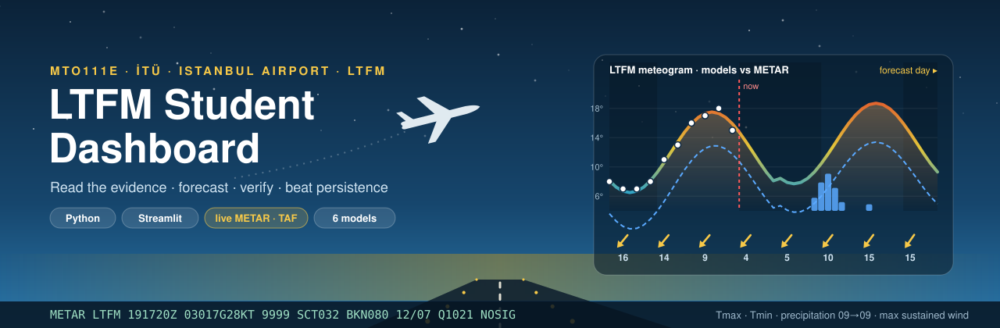

<p align="center"></p>

# LTFM Student Dashboard (Python)

**Istanbul Airport (LTFM) daily forecast competition · MTO111E · İTÜ**
İklim Bilimi ve Meteoroloji Mühendisliği Bölümü
Python / Streamlit version of the HTML *LTFM Student Dashboard*.

> Read the evidence · make your own forecast · check your errors · beat persistence · report honestly.

Every day you forecast **Tmax, Tmin (°C), precipitation 09:00→09:00 (mm) and maximum sustained wind (kt)** for
tomorrow at LTFM, submit by **21:00:00 Istanbul time**, then check yesterday’s forecast against the METARs.
The dashboard loads **live real data** (METAR, TAF, five global models, MET Norway, an ensemble, ERA5
climatology) and scores you against **persistence**. Nothing is invented: when a source cannot be reached,
the last real answer saved on your computer is shown, labelled with its date and time.

## Quick start

### Windows
1. Install Python 3.10 or newer from [python.org](https://www.python.org/downloads/) (tick *Add python.exe to PATH*).
2. Download or clone this repository.
3. Double-click **`run_dashboard.bat`**. The first start installs the packages (1–2 minutes); then the dashboard opens in your browser at `http://localhost:8501`.

### macOS / Linux / any terminal
```bash
git clone https://github.com/cyamanlar/ltfm-forecast-dashboard.git
cd ltfm-forecast-dashboard
python -m pip install -r requirements.txt
streamlit run app.py
```

## What is inside

| Tab | What you do |
|---|---|
| **1 · Check yesterday** | Fill Tmax, Tmin and wind from the LTFM METARs with one click, type the MGM 06–06 UTC precipitation, see your error, the persistence error, win/tie/loss and each model’s error. Write your daily learning note. Copy a ready AI question about your error. |
| **2 · Read weather** | Latest METAR decoded, last 24 h of observations, TAF decoded, all models hour by hour with METAR dots, a 3-hourly forecast table, reality check (METAR vs every model now), recent model bias, ensemble plume, MGM and ECMWF maps, Windy live map, crosswind calculator, links. |
| **3 · Make a forecast** | First idea → persistence (filled automatically from yesterday’s METARs) → **forecast coach** (Read → Check → Decide for each value, never gives the answer) → your four numbers, confidence, decision, reasoning → **Submit** (time-stamped and locked). Tomorrow’s ready daily model numbers appear only after you submit. |
| **4 · Review progress** | Participation (≥ 70% compulsory), calendar, MAE, bias, skill %, wins/ties/losses, overall success score, skill and error charts, climatology, best model, monthly progress, confidence test, your tendency. |
| **5 · Save your report** | Reflections and AI-use log, **CSV backup** (download or save into `backups/`), restore from CSV, printable end-of-semester report (*MTO111E_StudentID_Forecast_Report*), self-test of the scoring rules. |

## Your data

* Your records are saved in **`data/state.json`** on your own computer after every change.
* The CSV backup uses **exactly the same 39 columns as the HTML dashboard**, so backups from the HTML page
  (e.g. `LTFM_live_backup_2026-11-15.csv`) can be restored here (tab 5 → *Upload CSV to restore*) and the other way round.
* `data/` and `backups/*.csv` are in `.gitignore`: your personal log is **not** pushed to GitHub unless you
  remove those lines on purpose.

## Rules built into the code

* Deadline: 21:00:00 Istanbul (UTC+3, independent of your computer’s time zone) on the day before; 21:00:01 is late.
* One locked forecast per valid date; a second submission is refused.
* Observations: highest/lowest METAR temperature and highest sustained METAR wind of the Istanbul day (gusts do not count).
  Precipitation: MGM 06–06 UTC total; 0.0 mm when no METAR in 09:00→09:00 reports precipitation. A model analysis is never an observation.
* Persistence: the last complete day before you submit, saved with date and capture time.
* Skill % = 100 × (1 − my MAE ÷ persistence MAE). Missing values are never zero. The four variables are never added together.
* The scores are a **self-check**; official results come from the instructor.

## Data sources

Iowa Environmental Mesonet (LTFM METAR archive) · Open-Meteo forecast, previous-runs, ensemble and ERA5 APIs ·
MET Norway Locationforecast · NOAA Aviation Weather Center (TAF, METAR) · MGM (surface analysis) ·
ECMWF open charts (CC BY 4.0) · Windy.com. Credit every source you use.

## For developers

```
app.py              Streamlit user interface (5 tabs)
ltfm/config.py      course calendar, station, models, data-source addresses
ltfm/timeutil.py    Istanbul time, deadline, 09→09 precipitation day
ltfm/sources.py     live requests + saved real copies, parsers
ltfm/metar.py       METAR / TAF decoder
ltfm/observations.py daily values, persistence, model bias, ensemble statistics
ltfm/scoring.py     participation, exclusions, MAE, skill, wins/ties/losses
ltfm/coach.py       forecast coach texts and evidence
ltfm/storage.py     data/state.json and the CSV backup (HTML-compatible)
ltfm/report.py      printable report
ltfm/selftest.py    scoring checks (14/20, 21:00:00 vs 21:00:01, +25% skill, 47.5 overall, CSV round trip…)
tests/              pytest: rules + a full run of app.py without internet
```

Run the tests: `python -m pytest -q`. Simulate another time: `LTFM_NOW=2026-11-19T20:59:59+03:00 streamlit run app.py`.
The instructor changes the competition calendar in `ltfm/config.py` (`COURSE`).

---

### Türkçe özet

Her gün yarın için LTFM’de **Tmax, Tmin, 09→09 yağış ve maksimum sürekli rüzgâr** tahmini yapılır, en geç
**21:00:00**’de gönderilir ve ertesi gün METAR’larla kontrol edilir. Windows’ta **`run_dashboard.bat`** dosyasına
çift tıklayın; tarayıcıda panel açılır ve veriler canlı yüklenir. Kayıtlar `data/state.json` dosyasında tutulur;
CSV yedekleri HTML panelinin yedekleriyle aynı biçimdedir.
